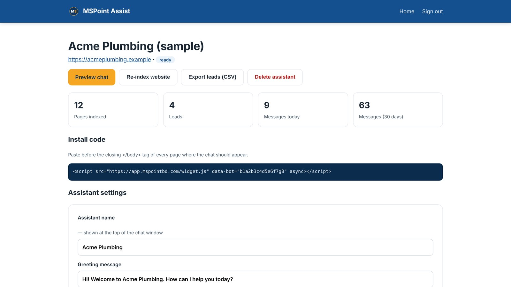
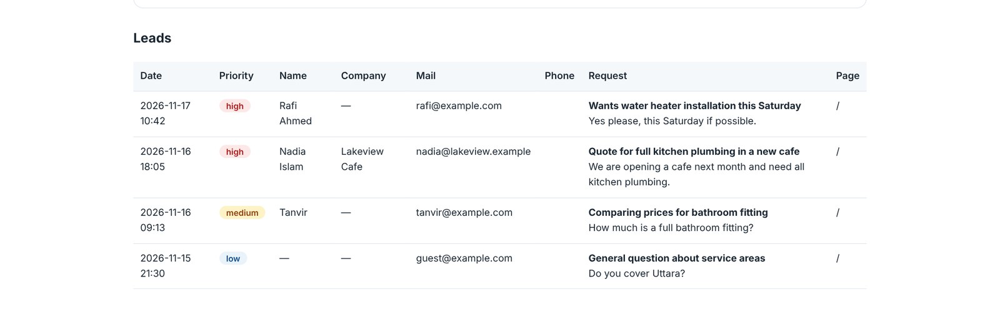

# MSPoint Assist

**AI support assistant for small business websites.** MSPoint Assist reads a business's public website, answers visitor questions 24/7 using only that content (with source links), and captures leads when a person is needed. It installs with one line of code.

Live: **https://app.mspointbd.com** · A product of **MSPoint LLC** (USA)

## Screenshots

**Owner dashboard** — usage, install code and assistant settings



**Leads** — every lead gets an AI priority and a one-line summary



<sub>Screenshots use sample data.</sub>

## Features

- Self-serve onboarding: enter business name, website and mail address, get an assistant in about a minute
- Same-site crawler (sitemap-first) built on `HTMLRewriter`, with owner-chosen **important pages** read first
- Retrieval-augmented answers: Workers AI embeddings (`bge-base-en-v1.5`) + Vectorize search + Llama 3.3 70B, with source links
- Core platform prompt: verified facts only, intent-aware sales and support, human handoff, multilingual replies
- **Custom instructions** per assistant (role, tone, focus), layered under the core rules
- Embeddable chat widget (Shadow DOM, no dependencies) with lead form that opens automatically when a visitor types a mail address
- **AI lead qualification**: high / medium / low priority, one-line summary and chat transcript on every lead
- **Lead alert mails**, welcome mail and **sign-in by mail** (one-time link that rotates the owner key), via Zoho ZeptoMail or Zoho Mail SMTP
- Owner dashboard: usage, install code, settings, leads, CSV export, re-index, preview page, delete
- **Admin dashboard** (`/admin`): every assistant with search and filters, suspend, plans, per-assistant limits, re-index, key reset, sign-in links, all leads with CSV export
- Security: Cloudflare Turnstile on signup, per-assistant daily quota, per-visitor hourly cap (hashed IP), owner keys stored as SHA-256 hashes, admin lockout after repeated failures, prompt-injection and prompt-leak guards in code
- Privacy Policy and Terms pages

## Architecture

Everything runs on Cloudflare's developer platform:

| Part | Cloudflare product |
|---|---|
| API and routing | Workers (`src/index.js`) |
| Landing page, dashboard, widget | Workers static assets (`public/`) |
| Embeddings and answers | Workers AI |
| Website knowledge (one namespace per assistant) | Vectorize |
| Assistants, leads, usage | D1 (`migrations/`) |
| Custom domain | `app.mspointbd.com` |

```
visitor ──► widget.js ──► /api/chat ──► Vectorize (namespace = bot) ──► Workers AI ──► answer + sources
owner   ──► /api/bots ──► crawler ──► chunk ──► Workers AI embeddings ──► Vectorize ; metadata ──► D1
```

## API

| Method | Path | Auth | Purpose |
|---|---|---|---|
| GET | `/api/health` | – | Health check |
| POST | `/api/bots` | – | Create assistant and index the website |
| GET | `/api/bots/:id/public` | – | Public name and greeting (used by widget) |
| POST | `/api/chat` | – | Ask a question `{bot, message, history}` |
| POST | `/api/leads` | – | Submit a lead `{bot, name, email, phone, message}` |
| GET | `/api/bots/:id` | Bearer owner key | Assistant details and usage |
| GET | `/api/bots/:id/leads` | Bearer owner key | Leads |
| POST | `/api/bots/:id/reindex` | Bearer owner key | Re-crawl and re-index |
| DELETE | `/api/bots/:id` | Bearer owner key | Delete assistant and all data |

## Install on a website

```html
<script src="https://app.mspointbd.com/widget.js" data-bot="YOUR_ASSISTANT_ID" async></script>
```

Optional attributes: `data-color="#14508f"`, `data-open="true"`.

## Setup (one time)

```bash
npm install
npx wrangler d1 create mspoint-assist          # paste database_id into wrangler.jsonc
npx wrangler vectorize create mspoint-assist --dimensions=768 --metric=cosine
npx wrangler d1 migrations apply DB --remote
npx wrangler deploy
```

### Continuous deployment

The Worker is connected to this repository with **Cloudflare Workers Builds**. Every push to `main` runs:

```
Build command:  npm test
Deploy command: npm run deploy:ci   (creates the Vectorize index if missing, applies D1 migrations, deploys)
```

GitHub Actions (`.github/workflows/ci.yml`) runs the unit tests and a `wrangler deploy --dry-run` on every push and pull request.

## Development

```bash
npm test            # unit tests (node --test)
npm run check       # bundle + config validation
npx wrangler dev    # local dev (AI and Vectorize use your Cloudflare account remotely)
```

## Roadmap

- Mail alerts for new leads
- Paid plans (Starter, Pro) with Stripe billing
- Custom branding and widget themes
- File uploads (PDF/FAQ) as knowledge sources via R2
- Conversation analytics and unanswered-question reports

## License

© MSPoint LLC. All rights reserved.
